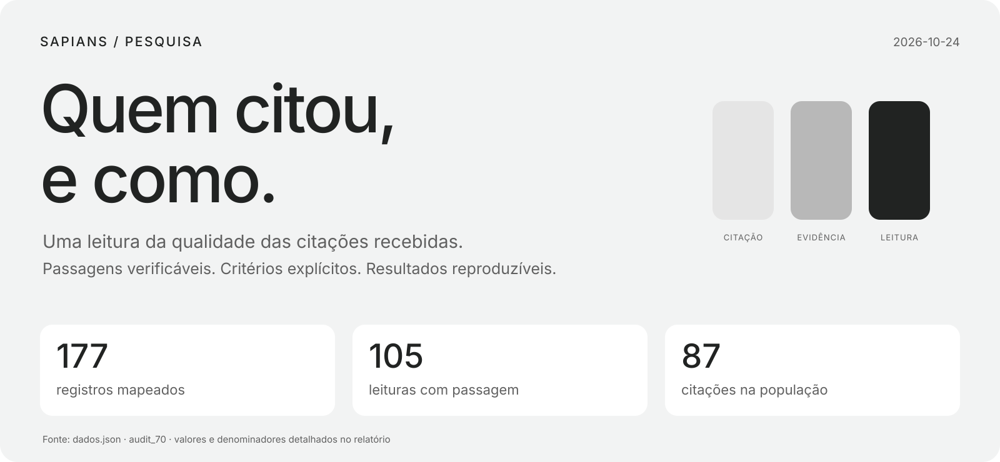
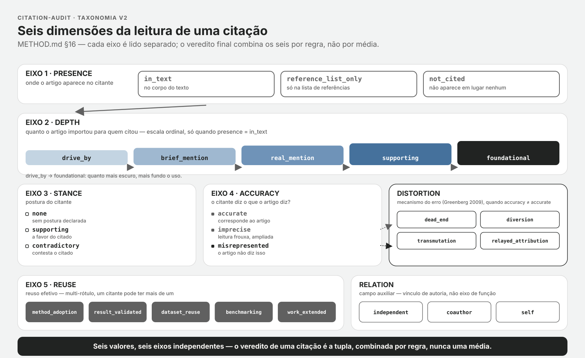
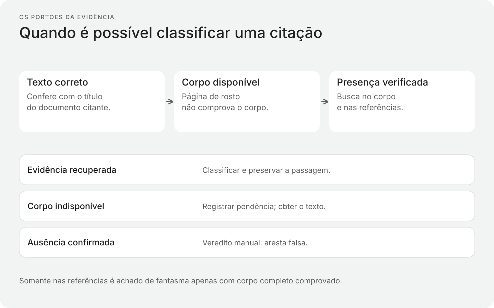
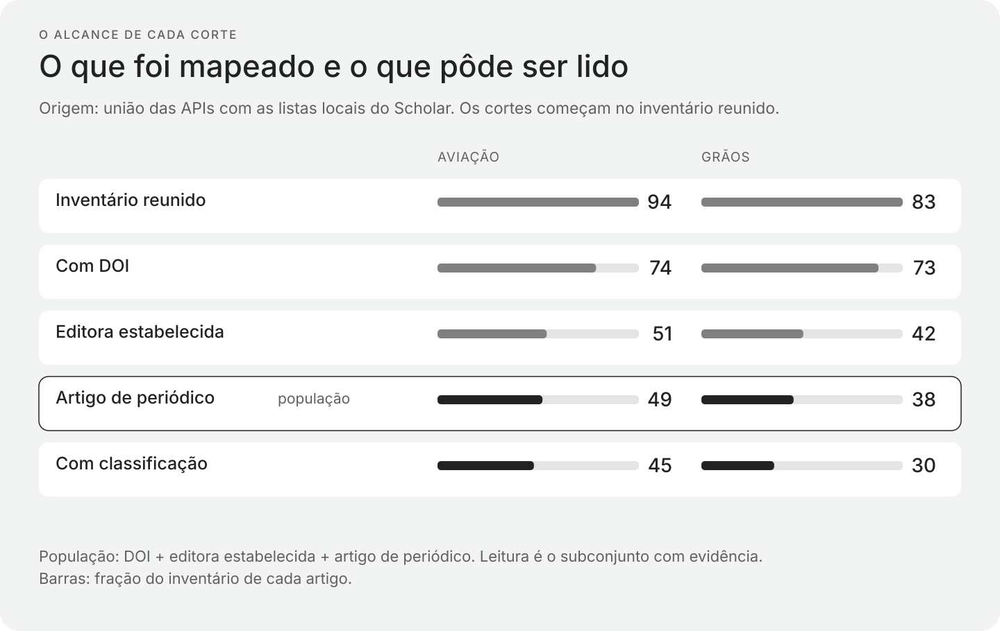
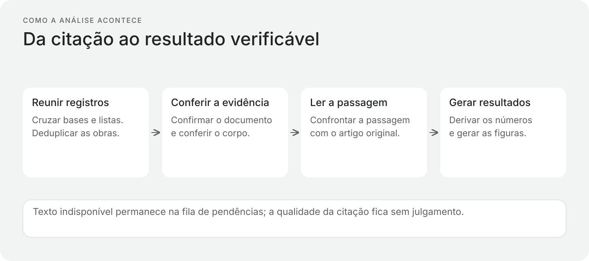
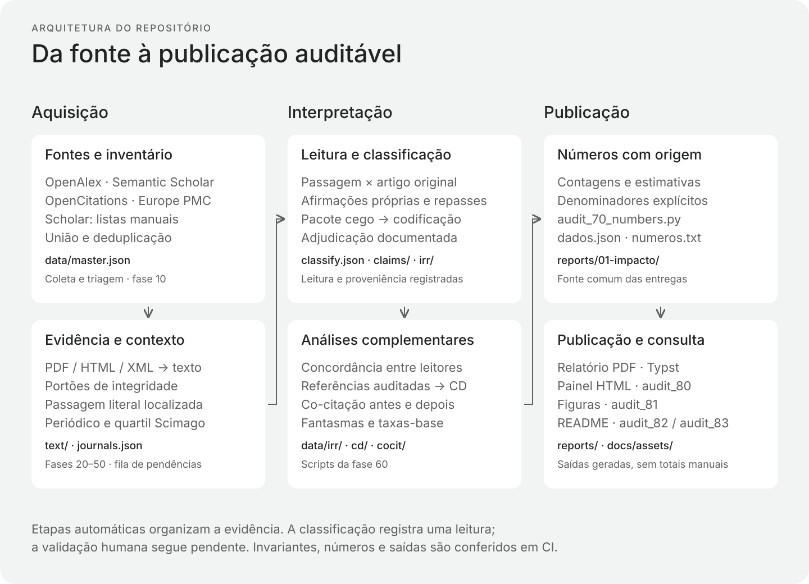

# citation-audit

<!-- Layout da capa: audit_70 §constantes, readme_mobile_breakpoint_px. -->
<picture>
  <source media="(max-width: 600px)" srcset="docs/assets/00-capa-mobile.svg">
  
</picture>

**O impacto de uma pesquisa também aparece no modo como ela é usada.**
Este projeto lê as citações recebidas por artigos de aviação e de perdas
pós-colheita: localiza a passagem, confronta o que foi dito com o original e
registra a evidência de cada julgamento.

[Relatório completo](reports/01-impacto/relatorio-impacto.pdf) ·
[Painel de consulta](reports/01-impacto/index.html) ·
[Revisão da atualização](reports/01-impacto/revisao-atualizacao.md) ·
[Método](METHOD.md) · [Arquitetura e reprodução](#5--arquitetura-e-reprodução)

## §1 — O que este repositório mede

A unidade de análise é a citação recebida. O interesse está no uso que o citante
faz do trabalho: menção de passagem, argumento apoiado, método adotado ou
atribuição que o artigo original não sustenta.

| Pesquisa auditada | Pergunta do artigo | Publicação |
|---|---|---|
| **Aviação** | Atrasos, internalização de congestionamento e entrada de empresas de baixo custo | *Transportation Research Part A* · [artigo](https://doi.org/10.1016/j.tra.2016.01.001) |
| **Grãos** | Determinantes macroeconômicos das perdas pós-colheita | *Sustainable Production and Consumption* · [artigo](https://doi.org/10.1016/j.spc.2019.09.002) |

Os títulos completos e as definições dos artigos estão em [config.json](config.json).
A população segue o critério registrado no [método](METHOD.md): DOI, editora
estabelecida e artigo de periódico. Os demais registros permanecem visíveis no
inventário, com seu tipo e suas limitações.

## §2 — Os achados

<!-- Gerado por tools/audit_83_review.py a partir de audit_70; não editar contagens à mão. -->
Cada número abaixo é impresso por `tools/audit_70_numbers.py`; o ponteiro indica
sua seção em `reports/01-impacto/numeros.txt`.

- **Inventário.** 177 registros, dos quais 147 com DOI; 105 têm classificação com passagem (`audit_70 §inventario`).
- **População.** 87 citações: 49 de aviação e 38 de grãos; 75 classificadas (`audit_70 §populacao`).
- **Cobertura.** Entre 98 registros com quartil oficial, 75 têm trecho literal, 6 são só-bibliografia sob a classificação documentada, 1 é aresta falsa e 16 seguem sem evidência (`audit_70 §cobertura`). A auditoria de corpos em disco é mais estrita que essa classificação histórica.
- **Presença e profundidade.** Das 105 leituras, 93 mencionam o artigo no corpo; 68 dessas menções são perfunctórias (73%). Outras 4 são fundacionais e 6 sustentam argumento ou desenho (`audit_70 §eixos`).
- **Exatidão.** 57 menções fiéis, 19 imprecisas e 17 com má atribuição; estas representam 18% das menções no corpo (`audit_70 §eixos`).
- **Teste cego.** O κ de exatidão entre os codificadores cegos permanece em 0,60, contra 0,14 e 0,15 nos pares com o original (`audit_70 §irr`). É resultado da coorte original; não valida automaticamente a leitura adicional. O contraste sugere dependência do instrumento, mas não isola um efeito causal.
- **Afirmações.** O registro contém 63 afirmações verificáveis; 35 aparecem em citações mapeadas (`audit_70 §alegacoes`).
- **Antes e depois.** CD5: -0,012 em aviação e 0,001 em grãos; DI5: 0,588 e 0,306, respectivamente (`audit_70 §cd`). A co-citação passa de 0,053 a 0,085 entre os períodos do estudo (`audit_70 §cocitacao`). São medidas descritivas, sem atribuição causal ao artigo.

A [revisão da atualização](reports/01-impacto/revisao-atualizacao.md) registra
coleta, leitura adicional, valores anteriores corrigidos e limites da análise.
Os comparadores publicados continuam pendentes de verificação primária.

## §3 — O método em uma tela

**Localizar a citação é o começo da leitura.** A auditoria separa perguntas que
uma contagem agregada não responde:

| Eixo | O que se verifica |
|---|---|
| Presença | O artigo aparece no corpo do texto ou apenas nas referências? |
| Profundidade | Quanto ele participa do argumento ou do desenho da pesquisa? |
| Postura | O citante apoia, contrapõe ou apenas menciona? |
| Exatidão | O que foi atribuído corresponde ao artigo original? |
| Reuso | Há adoção verificável de método, dado ou resultado? |

<!-- Layout: audit_70 §constantes, readme_mobile_breakpoint_px. -->
<picture>
  <source media="(max-width: 600px)" srcset="docs/assets/03-taxonomia-mobile.svg">
  
</picture>

Cada classificação preserva uma passagem literal, sua origem e a identificação
de quem codificou. O [registro de afirmações](data/claims/README.md) distingue os
achados próprios dos números que os artigos apenas repassam de outras fontes.
O teste cego verifica a concordância na coorte documentada em
[data/irr](data/irr/README.md).

**Acesso incompleto continua sendo acesso incompleto.** Os portões recusam texto
de outro artigo, página de rosto tratada como corpo e diagnóstico de citação
somente na bibliografia sem corpo comprovado. Ausência de acesso não vira
julgamento de qualidade.

<!-- Layout: audit_70 §constantes, readme_mobile_breakpoint_px. -->
<picture>
  <source media="(max-width: 600px)" srcset="docs/assets/04-portoes-mobile.svg">
  
</picture>

O funil começa no inventário reunido: as APIs e as listas do Scholar têm
coberturas diferentes. A partir dele, cada corte produz um subconjunto, até
chegar à população e à leitura com evidência:

<!-- Layout: audit_70 §constantes, readme_mobile_breakpoint_px. -->
<picture>
  <source media="(max-width: 600px)" srcset="docs/assets/02-funil-mobile.svg">
  
</picture>

As definições, os casos de fronteira e os limites de interpretação estão em
[METHOD.md](METHOD.md). A [revisão de literatura](docs/revisao-literatura.md)
registra o contexto dos indicadores e suas ressalvas.

## §4 — O relatório

| Entrega | Para que serve |
|---|---|
| [Relatório em PDF](reports/01-impacto/relatorio-impacto.pdf) | Ler a análise completa, figuras, discussão e inventário das citações classificadas |
| [Painel HTML](reports/01-impacto/index.html) | Consultar distribuições, registros e passagens |
| [Revisão da atualização](reports/01-impacto/revisao-atualizacao.md) | Conferir o que mudou, os valores corrigidos e o que permanece pendente |
| [Dados do relatório](reports/01-impacto/dados.json) | Consumir a mesma fonte que alimenta as figuras e a prosa |
| [Números por seção](reports/01-impacto/numeros.txt) | Verificar as medidas citadas no texto |
| [Fila de pendências](data/derived/pendencias.csv) | Ver quais citações ainda precisam de acesso ou classificação |

A apresentação segue a base global **VITA**: branco, superfícies cinza, preto
SAPIANS, hierarquia simples e números legíveis. Nas figuras de medida, uma paleta
analítica distingue categorias; padrões, contagens e formas de marcador
permitem acompanhar a leitura também em cinza. Terracota fica reservado às ações
reais. As fontes locais sob OFL mantêm a reprodução aberta. A adaptação está documentada em
[Design VITA](docs/design-vita.md).

## §5 — Arquitetura e reprodução

A cadeia de geração é explícita. Uma mudança nos dados percorre as mesmas fases
até chegar à figura e ao número impresso.

<!-- Layout: audit_70 §constantes, readme_mobile_breakpoint_px. -->
<picture>
  <source media="(max-width: 600px)" srcset="docs/assets/01-pipeline-mobile.svg">
  
</picture>

### Como as partes se conectam

A implementação separa aquisição de evidência, leitura e publicação. O inventário
registra de onde veio cada citação e se seu texto está disponível; a classificação
preserva o julgamento e a passagem que o sustenta. Análises complementares
produzem seus próprios artefatos, e a consolidação gera uma fonte comum de medidas.

<!-- Layout: audit_70 §constantes, readme_mobile_breakpoint_px. -->
<picture>
  <source media="(max-width: 600px)" srcset="docs/assets/05-arquitetura-mobile.svg">
  
</picture>

| Camada | Implementação e artefatos |
|---|---|
| Fontes e identidade | `audit_10` reúne OpenAlex, Semantic Scholar, OpenCitations e Europe PMC; `audit_12` incorpora as listas manuais do Scholar. Triagem e resolução completam metadados. O inventário é [master.json](data/master.json), com IDs e proveniência preservados. |
| Evidência e contexto | `audit_20`–`audit_22` recuperam textos; `audit_30`–`audit_32` verificam o documento e a passagem. `audit_40`/`audit_41` enriquecem periódicos e quartis; `audit_50` gera as filas. Texto incompleto continua pendente. |
| Leitura e afirmações | A passagem citante é confrontada com o artigo-fonte e o [registro de afirmações](data/claims/README.md). O julgamento fica em [classify.json](data/classify.json), com eixos, origem e evidência; recuperar texto não produz uma classificação automaticamente. |
| Teste cego e decisão | `audit_61` monta o pacote sem identidade nem rótulos; codificadores trabalham em contextos separados. `audit_62` mede concordância, e `audit_63_adjudicate` registra a adjudicação. Pacotes, rótulos e decisões ficam em [data/irr/](data/irr/README.md). |
| Análises complementares | `audit_64` audita referências; `audit_65` calcula disrupção; `audit_66` mede co-citação; `audit_67` verifica fantasmas; `audit_68` organiza taxas-base. Os clientes de grafo preservam snapshots e a cobertura é explicitada. |
| Consolidação e entregas | `audit_70` gera `dados.json` e `numeros.txt`. `audit_80` produz o painel; `audit_81`, as figuras; `audit_82`, os SVGs; `audit_83`, a revisão e os achados do README. Typst compila o relatório com as mesmas medidas e figuras. |

**Como a leitura foi feita.** A classificação original foi confrontada com
codificações de Claude Opus e Claude Sonnet sobre o pacote cego. Discordâncias
foram adjudicadas, com justificativas registradas. Isso mede concordância entre
modelos; a validação das afirmações pelo autor e a codificação humana continuam
pendentes. O desenho, as decisões e seus limites estão em
[METHOD.md](METHOD.md); a leitura adicional da atualização fica separada da
coorte original do teste cego.

**O que é gerado e o que é julgamento.** Inventários, filas, agregados e saídas
são derivados por scripts. Passagens, classificações e decisões de leitura são
evidência versionada, não totais recalculados. `check_data` verifica as
invariantes; `check_numbers` confere a prosa; os modos `--check` detectam saídas
desatualizadas. O CI exige consistência entre essas camadas.

O [guia dos scripts](tools/README.md#scripts) detalha entradas, saídas e ordem
de execução de cada etapa.

### Preparar o ambiente

Da raiz do repositório, com Python e o gerenciador `uv` disponíveis:

```bash
uv venv --python 3.12 .venv
uv pip install --python .venv/bin/python --require-hashes -r requirements.lock
brew install poppler
```

As fases de coleta e derivação usam a biblioteca padrão do Python. Estatística
e figuras usam as versões fixadas no ambiente acima; `pdftotext`, do Poppler,
extrai o texto dos PDFs. Em Linux, o pacote correspondente é `poppler-utils`.

### Refazer a derivação local

O bloco offline usa os dados e textos já presentes, sem consultar as bases.
Ele valida o material e atualiza as saídas derivadas:

```bash
python3 tools/audit_12_merge_scholar.py
python3 tools/audit_30_validate_texts.py
python3 tools/audit_31_passages.py
python3 tools/audit_32_gate_bibonly.py
python3 tools/audit_41_scimago.py
python3 tools/audit_50_pending.py
python3 tools/audit_70_numbers.py
python3 tools/audit_80_report_html.py
.venv/bin/python tools/audit_81_figures.py
python3 tools/audit_82_readme_svgs.py
python3 tools/audit_83_review.py
```

A atribuição Scimago exige a planilha local descrita em
[data/scimago](data/scimago/README.md). Para verificar um clone sem essa planilha,
use `audit_41_scimago.py --check`: ele valida as atribuições já versionadas.
Se leituras ou classificações mudaram, refaça antes as auditorias de fantasmas e
taxas-base, conforme [tools/README.md](tools/README.md#como-rodar).

### Conferir e compilar

```bash
python3 tools/check_data.py
python3 tools/audit_70_numbers.py --check
.venv/bin/python tools/audit_81_figures.py --check
python3 tools/audit_82_readme_svgs.py --check
python3 tools/audit_83_review.py --check
python3 -m unittest discover -s tests
pre-commit run --all-files
```

O modo `--check` compara a saída reproduzida com a versão salva. Para o PDF:

```bash
typst compile --root . --font-path tools/fonts reports/01-impacto/main.typ reports/01-impacto/relatorio-impacto.pdf
```

O guia de [compilação do relatório](reports/01-impacto/README.md) detalha a
conferência dos números. As fontes vendorizadas fazem parte do contrato de
reprodução. `check_data.py --local` também confere os textos disponíveis em disco.

**Nova coleta:** o bloco de rede está separado em
[tools/README.md](tools/README.md#como-rodar). Ele consulta bases públicas, registra
a execução e preserva IDs, evidências e decisões anteriores. O Scholar continua
sendo uma lista de entrada manual.

## §6 — Estrutura do repositório

| Caminho | Conteúdo |
|---|---|
| [tools/](tools/README.md) | Scripts de coleta, análise, geração e validação |
| [data/master.json](data/master.json) | Inventário de citações e estado de acesso |
| [data/classify.json](data/classify.json) | Julgamentos com passagem e proveniência |
| [data/claims/](data/claims/README.md) | Afirmações verificáveis dos artigos-fonte |
| [data/irr/](data/irr/README.md) | Pacote cego e concordância entre codificadores |
| `data/cd/` e `data/cocit/` | Grafos e análises de disrupção e co-citação |
| `data/baselines/` | Snapshot preservado para conferir correções |
| `data/derived/` | Filas de trabalho geradas |
| `reports/01-impacto/` | Relatório, dados, figuras, painel e revisão |
| `docs/assets/` | Capa e diagramas do README, gerados por script |

Os textos integrais e PDFs de terceiros ficam em [text/](text/README.md) e
[pdf/](pdf/README.md), fora do controle de versão. A planilha Scimago e os caches
de rede também não são redistribuídos.

## §7 — Limitações e pendências

- **Validação humana.** As afirmações extraídas dos artigos ainda precisam de
  validação pelo autor. O teste cego documenta concordância entre modelos;
  a codificação humana prevista no método continua pendente.
- **Cobertura de acesso.** Editoras e quartis têm cobertura desigual. A evidência
  recuperada não é uma amostra aleatória das citações recebidas.
- **Corpos não persistidos.** Parte das leituras institucionais foi documentada
  sem salvar o texto integral. A auditoria de fantasmas distingue esse limite
  dos casos com corpo comprovado em disco.
- **Leitura adicional.** A nova classificação da revisão de perdas pós-colheita
  tem passagem preservada e confronto com a fonte, mas aguarda leitura
  independente. Ela está fora do pacote cego original.
- **Comparadores e grafos.** Comparadores pendentes não são evidência verificada.
  As bases podem omitir referências, registrar versões diferentes e mudar entre
  coletas; CD e co-citação exigem cautela e não demonstram causalidade.

O estado de trabalho está no [ROADMAP](ROADMAP.md), e o histórico de mudanças no
[CHANGELOG](CHANGELOG.md). Correções sustentadas por evidência são bem-vindas:
[como contribuir](CONTRIBUTING.md).

## §8 — Como citar

[CITATION.cff](CITATION.cff) é a referência canônica e alimenta o botão
*“Cite this repository”* do GitHub. A autoria é de William Eduardo Bendinelli;
para uso em publicação, prefira os metadados desse arquivo.

## §9 — Licenças

**MIT** no código e **CC BY-SA** no texto e nos dados próprios. Veja
[licença do código](LICENSE) e [licença do conteúdo](LICENSE-CC-BY-SA-4.0.md).
Passagens citadas continuam pertencendo aos autores originais; os arquivos
integrais não são redistribuídos. Os dados do OpenAlex são CC0, e a planilha
Scimago segue seus termos próprios.

A política de evidência está em [CONTRIBUTING.md](CONTRIBUTING.md); o manual de
operação dos agentes, em [CLAUDE.md](CLAUDE.md).
